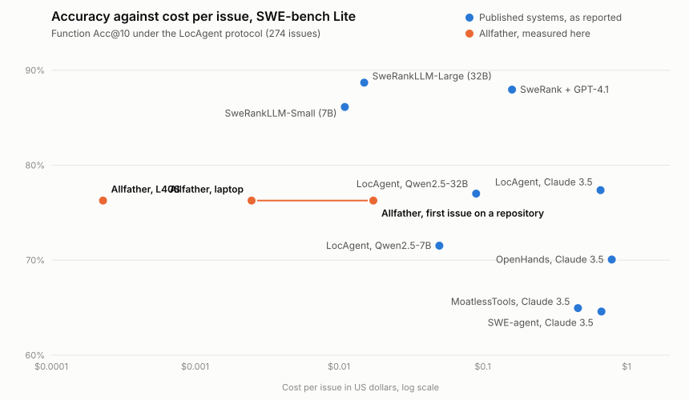
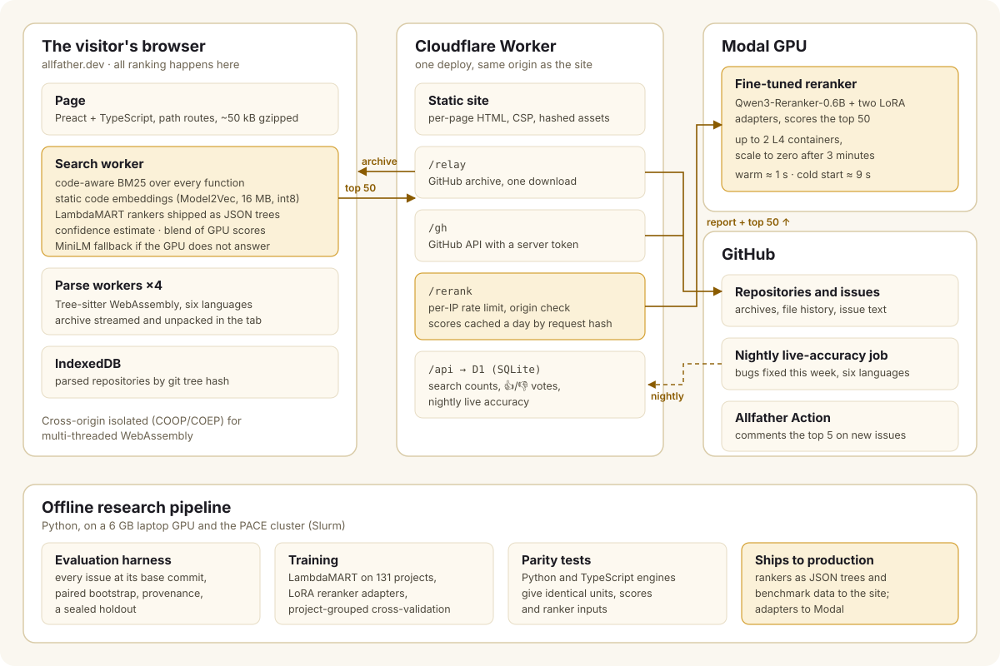
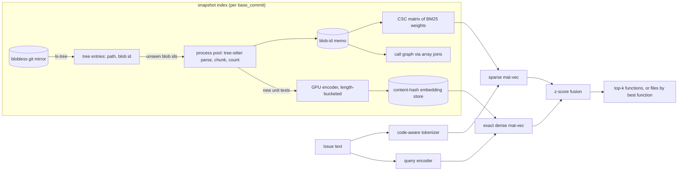
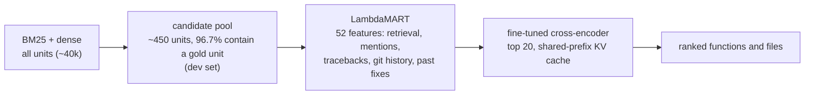
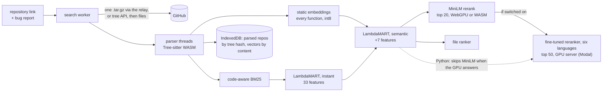

# Allfather

[](https://github.com/Lazeeez/Allfather/actions/workflows/parity.yml)
[](https://github.com/Lazeeez/Allfather/actions/workflows/live.yml)
[](LICENSE)
[](https://allfather.dev/)

**Given a bug report, find the code that has to change.** Allfather ranks every function in a repository against the report: code-aware keyword search and code embeddings for recall, then learned ranking and a fine-tuned language model for precision. Every design decision is scored on real bug fixes, where the answer key is the set of functions the maintainers' actual fix changed, and every claimed improvement comes with a paired significance test.

It ships three ways:

- **A website** for any public repository in Python, JavaScript, TypeScript, Go, Java or Rust: **[allfather.dev](https://allfather.dev/)**. Paste a repository and a bug report; parsing, indexing, embedding and ranking happen on your device, and an optional GPU server, off until you switch it on, re-reads the top 50 with a fine-tuned reranker.
- **A GitHub Action** that comments on new issues with the functions most likely to need the fix ([set-up](#github-action)).
- **A research pipeline** (`src/allfather`, Python): the full cascade on a GPU, evaluated on SWE-bench Lite, a sealed holdout, and fresh-2026, a pre-registered comparison with frontier AI agents on bugs reported after their training.

Two-minute version: the **[case study](https://allfather.dev/case-study)**. Every decision, including the ones that didn't work, is in [docs/decisions](docs/decisions/).

## At a glance

- **On 580 bugs reported after every compared model's training cutoff** (fresh-2026, six languages, 74 projects), Allfather finds a function the fix changed in its top 10 for **77.9%** of bugs, more than SweRank, the strongest published retriever (72.9%), and far more than frontier models asked once (gpt-6-astra 55.0%, Gemini 3.8 Flash 53.3%).
- **On the 198-bug agent subset it ties the best free coding agent** (gpt-6-luna in Codex, 77.3% against Allfather's 77.3% in the browser) and beats open-weight models as agents. Paid frontier agents are ahead (gpt-6-astra 86.9%); sending only the bugs Allfather is least sure about to that agent reaches 89.9%, more than the agent alone, at a little over half its cost.
- **It costs nothing in the browser** and about a tenth of a cent per bug with the GPU reranker, against $0.20 to $0.29 per bug for paid agents, and no code leaves the device unless the visitor opts in.
- **79.4% function hit@10 on SWE-bench Lite** with the full GPU cascade, and **79.7% on a sealed holdout** of 311 bugs from 184 projects it never saw, scored once after freezing.
- **Engineering:** Tree-sitter compiled to WebAssembly, LambdaMART rankers shipped as JSON trees, an int8 static code-embedding model, a LoRA fine-tuned Qwen3 reranker on Modal, one Cloudflare Worker, and a parity suite that holds the TypeScript engine to the Python one value for value.
- **Process:** 36 decision records, protocols written before results, every test-set evaluation logged, 166 Python tests, 97 unit tests and 71 end-to-end tests in Chromium, Firefox, WebKit and two phone profiles.

## Headline results

### Against frontier AI, on bugs they cannot have seen

Frontier models can answer older benchmarks from memory: on a SWE-bench Verified pilot, Claude Opus 5.5 given only the list of file names did as well as Claude reading the code. So I built **fresh-2026**: 580 bugs from 74 popular projects in Python, JavaScript, TypeScript, Go, Java and Rust, every one reported between 1 August and 2 November 2026, after the published training cutoff of every model compared. Of 9,270 candidate issues, 4,072 qualified; I drew up to 100 per language with at most 12 per project, excluded issues and fixes written by bots or AI agents, and sealed the answer keys by hash before anything ran on them. The comparison was written down in advance ([ADR 0033](docs/decisions/0033-frontier-comparison-protocol.md)), and every later change is a dated amendment written before the results it affects. Each system gets the full bug report and returns ten functions; agents get a read-only checkout and tools to list, search and read files, with web access off. The agents run on a stratified 198-bug subset.

Full reports, the 198-bug subset (function hit@k: a function the fix changed is in the top k; intervals from a bootstrap over projects; tests are exact and paired, Holm-adjusted across the whole table):

| System | Free | hit@1 | hit@10 [95% CI] | Cost per bug | vs Allfather + GPU (wins/losses, Holm p) |
|---|---|---|---|---|---|
| gpt-6-astra agent (Codex) |  | 79.3% | 86.9% [81.7, 91.5] | $0.28 | +10.1 (35/15, 0.198) |
| gpt-6-luna agent (Codex) | yes | 65.2% | 77.3% [70.9, 83.3] | $0.0032 | +0.5 (26/25, 1.000) |
| **Allfather, browser only** | yes | 46.0% | 77.3% [71.0, 83.1] | $0 | +0.5 (7/6, 1.000) |
| **Allfather + GPU reranker** | yes | 47.5% | 76.8% [69.8, 83.0] | $0.0012 | reference |
| SweRankEmbed-Large | yes | 40.4% | 72.7% [66.1, 79.6] | – | −4.0 (14/22, 1.000) |
| SweRankEmbed-Small | yes | 38.4% | 62.1% [54.5, 69.7] | – | −14.6 (11/40, 0.005) |
| Qwen3-Coder-Next agent | yes | 53.5% | 61.6% [53.5, 69.5] | $0.027 | −15.2 (15/45, 0.005) |
| gpt-6-astra, one call |  | 49.0% | 60.6% [51.9, 69.0] | $0.54 | −16.2 (16/48, 0.005) |
| Gemini 3.8 Flash, one call | yes | 42.4% | 55.6% [46.3, 64.9] | $0.10 | −21.2 (11/53, <0.001) |
| gpt-oss-120b agent | yes | 48.5% | 51.0% [42.3, 59.5] | $0.049 | −25.8 (10/61, <0.001) |
| gpt-6-luna, one call | yes | 37.4% | 42.9% [33.7, 52.4] | $0.0053 | −33.8 (4/71, <0.001) |
| Qwen3-Coder-Next, one call | yes | 31.8% | 40.9% [31.7, 50.0] | $0.0065 | −35.9 (5/76, <0.001) |
| gpt-oss-120b, one call | yes | 25.8% | 31.3% [22.8, 40.0] | $0.0063 | −45.5 (3/93, <0.001) |

All 580 bugs, for every system that ran on the whole set:

| System | hit@1 | hit@10 [95% CI] | vs Allfather + GPU (wins/losses, Holm p) |
|---|---|---|---|
| **Allfather + GPU reranker** | 46.7% | **77.9%** [73.4, 82.4] | reference |
| **Allfather, browser only** | 46.0% | 75.3% [70.1, 80.1] | −2.6 (12/27, 0.142) |
| SweRankEmbed-Large | 43.3% | 72.9% [66.5, 78.5] | −5.0 (35/64, 0.041) |
| SweRankEmbed-Small | 37.4% | 65.9% [59.4, 71.9] | −12.1 (30/100, <0.001) |
| gpt-6-astra, one call | 45.0% | 55.0% [48.5, 60.9] | −22.9 (33/166, <0.001) |
| Gemini 3.8 Flash, one call | 39.3% | 53.3% [47.1, 59.3] | −24.7 (26/169, <0.001) |
| gpt-6-luna, one call | 34.0% | 39.8% [33.3, 46.3] | −38.1 (8/229, <0.001) |
| Qwen3-Coder-Next, one call | 29.0% | 36.7% [30.6, 42.8] | −41.2 (10/249, <0.001) |
| gpt-oss-120b, one call | 21.7% | 27.2% [21.1, 33.5] | −50.7 (4/298, <0.001) |

What the numbers say:

- **Among free tools, Allfather is tied for first at hit@10** and significantly ahead of SweRank on the full set, of both open-weight models as agents and as single calls, and of every model asked once. Costs are list prices for the tokens each run used, or GPU rental time; SweRank's GPU time was not priced.
- **Agents rank better.** The free agent puts a changed function first for 65.2% of bugs against Allfather's 47.5%; ranking first is where agents earn their cost.
- **Paid agents are more accurate, and Allfather can decide when to call one.** Allfather's confidence estimate, with a threshold fixed before the study, escalates 56.1% of bugs to an agent and keeps its own answer for the rest. With gpt-6-astra that reaches 89.9% hit@10, against 86.9% for the agent on every bug and 82.4% for escalating the same number of bugs at random. On shortened reports, where Claude Opus 5.5 in Claude Code also ran, Claude reached 90.9% and the same gate, escalating 62.6%, reached 91.4% at about two thirds of its cost.
- **Models asked once fall far behind on new bugs.** gpt-6-astra reaches 60.6% asked once and 86.9% as an agent on the same bugs, while on the SWE-bench Verified pilot Claude asked once matched Claude as an agent. A model that cannot read the code is much weaker on bugs it cannot remember.
- **At file level the gap narrows.** Allfather's file ranker puts a changed file in its top 10 for 87.9% of the subset and 86.7% of all 580 bugs, level with Gemini (87.4% and 85.9%), behind the agents (89.4% to 93.4%), and still behind every frontier model at putting it first (63.6% against 68.7% to 87.9%).
- **Repeatability.** Asked again on 50 bugs, gpt-6-astra as an agent kept its outcome on all 50 and asked once changed it on 4; Allfather is deterministic.

Every number here is regenerated from the run records by `scripts/fresh_analysis.py`; the full tables, file-level results, per-language and per-hint breakdowns and run logs are in [results/research/](results/research/). A paper on this study is in preparation.

### On SWE-bench Lite

SWE-bench Lite test, 300 issues across 12 repositories, each searched at its own `base_commit`, out of 399 to 30,836 candidate functions per snapshot (about 10,900 on average). Nothing was trained or tuned on these issues, but the rankers trained on other issues from the same 12 projects and Lite guided development, so the sealed holdout below is the clean test. File-level rows score all 300; function-level rows score 291, the 300 minus the 9 whose fix touches only module-level code and so has no function or class to find.

| Final system (`ltr-ce-notests`) | hit@1 | hit@5 | hit@10 | recall@10 | MRR |
|---|---|---|---|---|---|
| **File that must change** (300 issues) | 69.0% | **89.3%** | **93.0%** | 0.930 [0.90, 0.96] | 0.783 |
| **Function that must change** (291 issues) | 45.0% | 73.9% | **79.4%** | 0.772 [0.72, 0.82] | 0.560 |

*hit@k*: at least one location the maintainers' fix touched is in the top k. Brackets are 95% bootstrap intervals.

For reference, plain BM25 started this project at 32.6% function hit@10 (recall@10 0.308, against 0.772 now).

### On bugs filed after its models, in projects it never saw

The question Lite cannot answer: does it hold up on bugs its models could not have seen, in unfamiliar projects? I built a sealed holdout for that before evaluating anything on it: issues created on or after 2025-09-01, after every pretrained model in the cascade was published (Allfather's own rankers and adapters were trained later, on other projects), from 184 projects that appear nowhere in training, tuning or testing ([ADR 0013](docs/decisions/0013-sealed-holdout.md)). I froze allfather-fast, hashed every model and declared every metric in advance, and then scored it once ([ADR 0032](docs/decisions/0032-freeze-allfather-fast.md)). The frozen configuration uses the rankers trained on more data ([ADR 0019](docs/decisions/0019-more-ranker-training-data.md)), so its Lite row is scored again here.

| Frozen allfather-fast | Bugs | hit@1 | hit@5 | hit@10 | all@10 | MRR |
|---|---|---|---|---|---|---|
| **Holdout, function** | 311 | 51.4% | 71.1% | **79.7%** [74.9, 83.9] | 47.3% | 0.602 |
| **Holdout, file** | 321 | 67.0% | **90.3%** | 94.7% [92.2, 96.9] | 81.0% | 0.771 |
| Lite, function | 291 | 43.3% | 72.2% | 78.4% [73.5, 82.8] | 73.5% | 0.543 |
| Lite, file | 300 | 68.3% | 88.7% | 93.0% [90.0, 95.7] | 93.0% | 0.777 |

It finds one of the changed functions as often on the holdout as on Lite. Finding all of them is harder there: its fixes change 3.0 functions on average against 1.2 on Lite, so all@10 falls from 73.5% to 47.3%. The two sets differ in projects, fix size and date, so this is a description, not a controlled comparison. Every declared metric with its interval is in [results/frozen/report.json](results/frozen/report.json).

### Next to published systems

Scored the way LocAgent and SweRank score themselves: 274 Lite issues, and an issue counts only when every location its fix changed is in the top k (Acc@k, in %).

| System | Models | Source | File Acc@1 | File Acc@5 | Function Acc@5 | Function Acc@10 |
|---|---|---|---|---|---|---|
| OpenHands | Claude 3.5 | reported | 76.28 | 90.15 | 68.25 | 70.07 |
| LocAgent | Claude 3.5 | reported | 77.74 | 94.16 | 73.36 | 77.37 |
| SweRank | 7B retriever, 32B reranker | reported | 83.21 | 95.99 | 81.39 | 88.69 |
| Allfather (`ltr-ce-notests`) | 0.5B retriever, 0.6B reranker | scored here | 68.98 | 90.51 | 70.80 | 76.28 |

Allfather is level with the best agent of the LocAgent paper at function level and behind SweRank, with models an order of magnitude smaller; it is behind both at file level. The other rows are copied from the papers' tables and have not been re-run here. Sources, every other row, intervals, costs and what this means for the plan are in [docs/comparison.md](docs/comparison.md); the rules were fixed beforehand in [ADR 0014](docs/decisions/0014-comparison-protocols.md).

### What it costs

The full cascade takes 0.44 seconds per issue on an NVIDIA L40S (median 0.40), and the reranker is the largest stage. At a public rental price for that GPU that is about $0.0002 per issue, against $0.011 to $0.015 for SweRank's rerankers and $0.46 to $0.79 for agents running Claude 3.5, as their papers report them. On the laptop's 6 GB GPU (RTX 4050) the same cascade takes 8.8 seconds per issue, median 3.5 seconds, and the reranker is 96% of that; priced the same way, that is about $0.0025 per issue. The stage-by-stage table, the assumptions behind the dollar figure and the chart are in [docs/cost.md](docs/cost.md).



### In the browser, on projects it never saw

The website runs a lighter pipeline in the browser (no git history) with rankers trained on 7,843 issues from 192 projects: 5,115 Python issues from 131 projects, and 2,728 from 61 projects in JavaScript, TypeScript, Go, Java and Rust ([ADR 0025](docs/decisions/0025-more-languages.md)). It is scored on 30 projects kept out of training entirely, the situation of every repository a visitor pastes: 747 bugs, the 785 sampled minus the 38 with no function or class target ([ADR 0011](docs/decisions/0011-website-at-scale.md)):

| In-browser stage | hit@1 | hit@10 | MRR |
|---|---|---|---|
| keyword search only | 32.9% | 66.0% | 0.435 |
| instant learned ranking | 44.2% | 74.7% | 0.542 |
| + static-embedding semantic index | 43.9% | **76.6%** | 0.544 |
| + MiniLM rerank of the top 20 | 44.0% | 76.4% | **0.549** |
| **file ranker** (the file that must change) | 68.0% | **94.2%** | 0.774 |

Against the Python-only ranker these replace (77.2% function hit@10 after either stage, 94.4% for files), adding five languages and the Rust rule of [ADR 0027](docs/decisions/0027-rust-test-modules.md) moved Python by under a point (76.6% and 76.4%, 94.2%); that ranker's per-issue results were not kept, so the change is not tested for significance. On SWE-bench Lite (291 issues) the browser pipeline reaches 69.1% function hit@10 against the GPU pipeline's 79.4%.

### The website's GPU reranker

The site can send the bug report and its top 50 functions to a GPU server (Modal), where a fine-tuned reranker scores them, and blend the scores into the browser's order. The first version, two LoRA adapters on Qwen3-Reranker-0.6B trained on Python, served Python repositories only. I measured it before building it, out of fold on 3,174 bugs from 119 projects the reranker never trained on ([ADR 0021](docs/decisions/0021-website-server-reranker.md)): function hit@10 79.3% → 81.9% (+2.6 points, 95% interval [1.8, 3.4], p < 0.001) and hit@1 44.3% → 50.0%. With it, the browser's own language model adds nothing measurable (hit@10 81.9% with it, 81.7% without, p = 0.32), so the site skips that 50 MB download whenever the GPU answers ([ADR 0026](docs/decisions/0026-skip-browser-language-model.md)). Scored once on held-out data with the site's final configuration: function hit@10 67.0% → 73.5% on Lite (+6.5 points, 95% interval [3.4, 10.0], p < 0.001) and 76.6% → 79.3% on the 30 unseen projects (+2.7, [1.1, 4.3], p = 0.002).

Since November 2026 the server runs one LoRA adapter trained on bugs from all six languages, chosen from three candidates by a rule fixed in advance ([ADR 0034](docs/decisions/0034-gpu-reranker-other-languages.md)). Cross-validated with whole projects held out, it lifts function hit@10 in every language: Python 79.3% → 83.6%, Go 68.9% → 73.3%, Java 62.9% → 70.1%, JavaScript 68.3% → 72.8%, TypeScript 56.3% → 61.3% and Rust 73.3% → 83.3%. Its scores are blended with weight 1 in Python and 2 elsewhere. The browser skips its own language model when the GPU answers only for Python, the one language where I have tested that it costs nothing (hit@10 +0.1 points, 95% interval [−0.3, 0.5], p = 0.77); in the other five the GPU re-reads the language model's order, as in the configuration I evaluated. The reranker is off until a visitor switches it on, because it sends the bug report and the top 50 functions off the device; the search page offers it next to the results, more firmly when its own confidence is low.

The reranker reads at most 512 tokens of a report, and most fresh-2026 reports are longer. I tested two fixes on the training bugs against a rule fixed in advance ([ADR 0036](docs/decisions/0036-reranker-reads-the-whole-report.md)): the same adapter reading 2,048 tokens gained 0.6 points of function hit@10 on reports over 2,000 characters (not significant), and an adapter retrained on 2,048 tokens gained 1.3 points (p = 0.015). The rule asked for 2 points, so the site keeps the current adapter; reading more of a report helps, but by less than its cost in a new release.

### Live, on bugs fixed this week

A nightly job collects bugs that popular projects in all six languages fixed in the past week, runs the website's pipeline at the commit before each fix, and scores where the changed function ranked ([ADR 0023](docs/decisions/0023-live-accuracy.md), [results/live/](results/live/)). The first night, 2026-10-15, with the Python-only ranker: 80 bugs from 13 projects, function hit@10 66.3% [56.3, 76.3], file hit@10 90.0%. Since 2026-10-16 it also covers JavaScript, TypeScript, Go, Java and Rust projects and reports each language. By 2026-11-10 it had scored 866 bugs from 41 projects: a function the fix changed was in the top 10 for 70.4% (95% interval 67.4 to 73.4), and the file for 89.5%. On the 441 bugs from projects the rankers never trained on, function hit@10 is 76.0%; on projects they did, 64.7%. The site's live page shows the last 30 days.

### In the browser, in other languages

The same rankers on bugs in other languages, from two public test sets and projects they never trained on, against ranking by keywords and meaning alone (function hit@10). The sets were rescored after label and cache fixes, each run logged and nothing decided from them. p is an exact paired test per row; the last column adjusts it for the eight rows with Holm's method, after which only the PolyBench gains are significant:

| Language | Test set | Bugs | Allfather | Keywords and meaning | Change | Holm-adjusted p |
|---|---|---|---|---|---|---|
| Go | SWE-bench Multilingual | 37 | 64.9% | 46.0% | +18.9 (p = 0.039) | 0.196 |
| Java | SWE-bench Multilingual | 43 | 81.4% | 67.4% | +14.0 (p = 0.070) | 0.281 |
| JavaScript | SWE-bench Multilingual | 26 | 57.7% | 50.0% | +7.7 (p = 0.625) | 0.625 |
| Rust | SWE-bench Multilingual | 41 | 65.8% | 53.7% | +12.2 (p = 0.180) | 0.375 |
| TypeScript | SWE-bench Multilingual | 14 | 50.0% | 21.4% | +28.6 (p = 0.125) | 0.375 |
| Java | SWE-PolyBench | 125 | 71.2% | 55.2% | +16.0 (p < 0.001) | <0.001 |
| JavaScript | SWE-PolyBench | 115 | 79.1% | 55.6% | +23.5 (p < 0.001) | <0.001 |
| TypeScript | SWE-PolyBench | 100 | 60.0% | 44.0% | +16.0 (p < 0.001) | 0.002 |

### On a public leaderboard: Long Code Arena

JetBrains' Long Code Arena scores bug localization by the set of files a system names: precision, recall and F1, no credit for ranking ([ADR 0035](docs/decisions/0035-long-code-arena.md)). Allfather reads its Python and Java bugs but not Kotlin. I chose how many files to name on 150 training bugs per language (Python: the top file; Java: the top two and their test files), then ran the hand-checked test split once: F1 0.401 on the 100 Python and Java bugs, precision 0.51, recall 0.41. On the leaderboard's F1 that sits between GPT-4o mini (0.416) and Llama 3.1 70B (0.351), though their scores also include Kotlin. The ranking is stronger than the set score suggests: a changed file is first for 60 of the 100 bugs and in the top five for 88. A fixed number of files cannot follow how many files a fix changes, which is where the language models gain; I have not submitted this entry.

### Every retriever

File rows: 300 issues. Function rows: 291 issues (300 minus the 9 that are module-level only).

| Retriever | Level | Recall@1 | Recall@5 | Recall@10 | All@10 | MRR |
|---|---|---|---|---|---|---|
| random | file | 0.003 | 0.013 | 0.017 [0.00, 0.03] | 0.017 | 0.008 |
| bm25-naive | file | 0.340 | 0.617 | 0.693 [0.64, 0.75] | 0.693 | 0.457 |
| bm25-code | file | 0.363 | 0.647 | 0.727 [0.67, 0.78] | 0.727 | 0.487 |
| bm25-code-notests | file | 0.457 | 0.723 | 0.790 [0.74, 0.83] | 0.790 | 0.571 |
| dense-notests | file | 0.483 | 0.800 | 0.873 [0.83, 0.91] | 0.873 | 0.621 |
| hybrid-notests | file | 0.583 | 0.850 | 0.917 [0.88, 0.95] | 0.917 | 0.698 |
| ltr-notests | file | 0.627 | 0.883 | 0.930 [0.90, 0.96] | 0.930 | 0.741 |
| **ltr-ce-notests** | file | **0.690** | **0.893** | **0.930** [0.90, 0.96] | 0.930 | **0.783** |
| bm25-naive | function | 0.141 | 0.249 | 0.308 [0.26, 0.36] | 0.289 | 0.203 |
| bm25-code | function | 0.154 | 0.329 | 0.428 [0.37, 0.49] | 0.406 | 0.247 |
| bm25-code-notests | function | 0.190 | 0.427 | 0.519 [0.46, 0.58] | 0.491 | 0.307 |
| bm25-code-notests-graph | function | 0.194 | 0.427 | 0.523 [0.47, 0.58] | 0.495 | 0.312 |
| dense-notests | function | 0.225 | 0.479 | 0.586 [0.53, 0.64] | 0.564 | 0.365 |
| hybrid-notests | function | 0.269 | 0.569 | 0.642 [0.59, 0.69] | 0.622 | 0.416 |
| ltr-notests | function | 0.344 | 0.643 | 0.729 [0.68, 0.78] | 0.708 | 0.497 |
| **ltr-ce-notests** | function | **0.407** | **0.706** | **0.772** [0.72, 0.82] | 0.746 | **0.560** |

I made every tunable choice on data disjoint from Lite: a dev set (SWE-bench Verified minus Lite) for fusion and expansion, and SWE-bench test minus Lite (1,941 issues) for the learned rankers.

### What each step bought (paired tests, function level, 291 issues: 300 minus 9 module-level-only)

| Change | ΔRecall@10 | 95% CI | p | Wins / losses |
|---|---|---|---|---|
| naive → code-aware tokenizer | **+0.121** | [+0.076, +0.166] | <0.001 | 50 / 11 |
| + exclude test files | **+0.091** | [+0.058, +0.126] | <0.001 | 32 / 2 |
| + call-graph expansion (dev-tuned) | +0.003 | [+0.000, +0.010] | 1.00 | 1 / 0 |
| BM25 → dense embeddings alone | +0.066 | [+0.002, +0.129] | 0.042 | 63 / 43 |
| dense → hybrid (dev-tuned fusion) | **+0.057** | [+0.019, +0.096] | 0.003 | 30 / 11 |
| **BM25 → hybrid, overall** | **+0.123** | [+0.070, +0.174] | <0.001 | 57 / 17 |
| hybrid → learning to rank (LambdaMART) | **+0.087** | [+0.049, +0.128] | <0.001 | 36 / 9 |
| LTR → + fine-tuned cross-encoder (ensemble of 2) | **+0.043** | [+0.013, +0.074] | 0.005 | 24 / 7 |

The cross-encoder's main job is the top of the list: function MRR +0.063 and recall@1 +0.063 (both p < 0.01), file MRR +0.042 and recall@1 +0.063 (p < 0.01). Earlier LTR and cross-encoder numbers were measured on a corrupted embedding store and are superseded ([ADR 0008](docs/decisions/0008-embedding-store-corruption.md)).

- **Code-aware tokenization** splits `get_queryset` and `HTTPServerError` into parts and keeps the whole identifier too, so both prose ("query set") and exact mentions match. It helps most at depth. At recall@1 the gain (+0.012) is not significant.
- **Excluding tests** is the largest lexical win at recall@1 (+0.037, p = 0.006); hybrid retrieval, learning to rank and the cross-encoder each add more later. Test methods reuse every identifier in the issue, so they crowd out the source.
- **Call-graph expansion does not pay for itself.** I tuned it on a held-out dev set and confirmed it on test. [ADR 0004](docs/decisions/0004-call-graph-expansion.md) shows why: only 15% of misses are one call away from a top hit, so the ceiling is low. It ships as opt-in.
- **Learning to rank turns many weak signals into one ordering** ([ADR 0006](docs/decisions/0006-learning-to-rank.md)). The candidate pool already held a gold unit for 96.7% of issues, measured on the dev set, so the remaining errors were about order. LambdaMART learns it from 52 features: retrieval scores, the issue title and code spans scored separately, traceback frames and names mentioned in the issue, file structure, git history from strict ancestors of the base commit (BugLocator-style churn and similar past commits), and fixes of similar earlier issues.
- **A fine-tuned LLM reranker reads the issue and the code together** ([ADR 0007](docs/decisions/0007-fine-tuned-cross-encoder.md)). Zero-shot it added nothing, but after one LoRA epoch on in-domain hard negatives it lifts the top ranks. It runs only on the top 20, with a shared-prefix KV cache so the issue is encoded once per query rather than once per candidate.
- **Hybrid is the big win, because the two retrievers fail differently.** Dense alone is only marginally better than BM25 (p = 0.042), but fusing them beats both. Recall@10 is +12.7 points at file level too, with 42 wins to 4 losses. The largest gains are where issues aren't written in identifiers: sympy recall@10 went from 0.37 to 0.59 and pytest from 0.30 to 0.56 ([ADR 0005](docs/decisions/0005-dense-hybrid-retrieval.md)).

Reproduce any row: `make eval RETRIEVER=bm25-code-notests LEVEL=function`, then `uv run allfather compare results/A.json results/B.json`.

## Performance

Indexing every Lite snapshot at function level and answering its issue with `bm25-code-notests`: 291 snapshots, 188,880 files. Measured on 2026-10-13 on a laptop (Core i5-13420H, 12 logical cores, 32 GB, Windows 11) by `benchmarks/bench_lite_index.py`; the output is [results/perf/lite_index_2026-10-13.json](results/perf/lite_index_2026-10-13.json).

| | No disk cache | Cold disk cache | Warm disk cache |
|---|---|---|---|
| End-to-end wall time | 110 s | 119 s | **43 s** |
| Index build p50 / p95 | 276 / 630 ms | 304 / 762 ms | **101 / 216 ms** |
| Query latency p50 / p99 | 0.43 / 1.14 ms | 0.39 / 0.89 ms | 0.38 / 0.96 ms |
| Blobs parsed | 26,159 | 26,148 | 0 |

- **Within one run, 86% of files are never parsed.** They are byte-identical to a file in a snapshot already indexed, so 188,880 files cost 26,159 parses.
- **The analysis cache** (SQLite, keyed by blob id plus a fingerprint of the parser and tokenizer *source code*, so editing either invalidates exactly the stale entries) carries that reuse across runs: a repeat run takes 43 s.
- **The ranked output is identical in all three runs.** The benchmark hashes every ranking and compares.

An earlier version of this table compared against the project's first working version. That code predates the git history and cannot be run again, so the comparison was removed rather than kept unverifiable.

Where the time went, and what fixed it:

- **Git reads.** One long-lived `git cat-file --batch` process instead of two subprocesses per file.
- **Content addressing: 7× less parsing.** Work is memoized by blob id, and most files in a snapshot are byte-identical to a file in a snapshot already indexed.
- **Bulk fetch.** Each repository's missing blobs for every needed commit are found with one `cat-file --batch-check` (lazy fetch disabled) and downloaded with one `git fetch --stdin`, instead of one lazy round trip per object.
- **No Python loop over documents.** BM25 weights are precomputed into a scipy CSC matrix, so a query is a column slice plus one sparse mat-vec. Path terms are added to every chunk with a single sparse product, and the call graph is resolved with sorted-array joins.
- **Tokenization collapses repeats in C.** `Counter(re.findall(...))` runs first, so each distinct identifier is split once, not once per occurrence.
- **Parsing in a process pool.** Tree-sitter holds the GIL, so threads did nothing. Workers return compact arrays against a blob-local term table, and the main process interns each blob's distinct terms with one gather.

### Dense retrieval

| | |
|---|---|
| Unit slots across the 684 snapshots evaluated at function level (291 Lite, 393 dev) | 6.67M |
| Distinct unit texts actually embedded (content-hash store) | **185k (36.1× fewer)** |
| GPU time to embed them at the 204 units/s measured below (RTX 4050, fp16) | about 15 min, instead of about 9 h |
| Units that needed embedding for the Lite run after dev tuning | 8.5k |

Batching (4000 django units, `benchmarks/bench_batching.py`, output in [results/perf/bench_batching_2026-10-13.json](results/perf/bench_batching_2026-10-13.json)):

| Strategy | Units/s | Real / padded tokens |
|---|---|---|
| Fixed batches of 32 in file order | 42 | 21% |
| Length-sorted, batches of 32 | 199 | 98% |
| **Length-sorted, 4096-token budget** | **204** | 98% |

Sorting is nearly all of the 4.9× gain. Budget packing adds about 3%, and larger budgets are slower once the GPU is saturated.

**Why not A\*, WAND or HNSW?** Pruning search (best-first graph search in HNSW, admissible upper bounds in WAND/MaxScore) buys cheaper scoring with extra build work. On a django snapshot of 8,863 units (`benchmarks/bench_search.py`, output in [results/perf/bench_search_2026-10-13.json](results/perf/bench_search_2026-10-13.json)):

| Step | ms |
|---|---|
| Encode the issue text (GPU) | 27 |
| BM25 over all units | 0.06 |
| Exact dense search, GPU / CPU | 0.14 / 0.49 |
| HNSW build (FAISS, M=16 / M=32) | 639 / 666 |
| HNSW query | 0.07 to 0.24 |

Each snapshot answers one query, so HNSW would need about 10,000 queries on the same commit to repay its build against exact search on the GPU (639 ms of build for 0.06 ms saved per query). Exact search is both faster and lossless here. The time that matters is query encoding and indexing new code, which is where the optimization went.

## Architecture

The system as deployed: ranking runs in the visitor's browser, one Cloudflare Worker serves the site and relays GitHub and the GPU, and a research pipeline on a laptop and the PACE cluster trains every model the site ships.



The search pipeline inside it:



The ranking cascade on top: each stage is more expensive per candidate and sees fewer of them.



The same cascade in the browser, with an optional GPU stage:



- **Chunk = the unit ground truth is labelled with.** Each non-nested function, method and class is a chunk. A class chunk holds only the lines its methods don't own (header, docstring, attributes). Everything else is a module chunk used for file-level search.
- **Every issue is searched at its own `base_commit`.** Searching at HEAD leaks the fix ([ADR 0002](docs/decisions/0002-index-at-base-commit.md)).

## Tech stack

| Layer | Tools |
|---|---|
| Research pipeline | Python 3.11+, uv, Tree-sitter, NumPy/SciPy (sparse BM25), PyTorch + sentence-transformers (jina-code embeddings), LightGBM (LambdaMART), Hugging Face PEFT/LoRA on Qwen3 (cross-encoder), SQLite (analysis cache), git (blobless mirrors, `cat-file --batch`) |
| Website | TypeScript (strict), Preact, Vite, Web Workers, Tree-sitter compiled to WebAssembly (six languages), Model2Vec static embeddings (int8), Transformers.js + ONNX Runtime (MiniLM on WebGPU or WASM, the fallback), IndexedDB, a service worker (COOP/COEP isolation, offline cache) |
| Hosting | One Cloudflare Worker at allfather.dev (`deploy/cloudflare/`, `proxy/`): static files, a relay for repository archives (`/relay`), a GitHub API proxy with a token and an edge cache (`/gh`), search counts and votes in D1 (`/api`), and the GPU reranker's front door (`/rerank`), which checks, rate-limits and caches requests to a Modal endpoint (`deploy/modal/reranker.py`) |
| Quality | pytest, Vitest, Playwright end-to-end tests (desktop and phone), a Python/TypeScript parity suite, ruff, GitHub Actions CI, axe accessibility checks |
| Research computing | The PACE cluster at Georgia Tech (Slurm; L40S, A100 and H100 GPUs) for reranker training and open-weight models served with vLLM; a 6 GB laptop GPU (RTX 4050) for everything else |
| Frontier comparison | Codex CLI (gpt-6-luna, gpt-6-astra), Claude Code (Claude Opus 5.5), the Gemini API, vLLM (Qwen3-Coder-Next, gpt-oss-120b) in a read-only agent harness of my own, SweRank's published retrievers |
| Paper | LaTeX (ACM `acmart`), every table, figure and number generated from the run records by `scripts/paper_tables.py` |
| Data | SWE-bench (Lite, Verified, full), SWE-rebench (CC-BY-4.0) for 150 more projects, Multi-SWE-RL, SWE-bench Multilingual, SWE-PolyBench, Long Code Arena, and fresh-2026, built here from GitHub |

## Evaluation methodology

- **Ground truth** comes from the gold patch, mapped onto a Tree-sitter parse of each file *as it existed at `base_commit`* (details below).
- **Unseen projects for the website.** The browser's rankers are cross-validated with whole projects as folds, and scored on 30 SWE-rebench projects that appear in no training fold, so the reported numbers are what a visitor's new repository gets.
- **Held-out tuning.** Anything with a knob is tuned off Lite: fusion and expansion on SWE-bench Verified minus Lite (407 issues, `allfather tune`), learned rankers on SWE-bench test minus Lite (1,941 issues, `allfather ltr`, 5-fold CV grouped by query), and the reranker's depth and weights on 250 issues held out from its training (`allfather ce-tune`), with the selection rule written down before looking.
- **How often Lite has been looked at.** I trained or tuned no number here on Lite, but Lite is not untouched: I have scored it 92 times, and [results/test-evals.log](results/test-evals.log) lists each one with what was decided from it. Most are one run per reported row. The exceptions: I scored the early browser pipeline on Lite at several rerank depths and with two stage-2 models (I chose its settings on dev data and cross-validation, but I looked at Lite each time), and I rejected the distilled reranker on a Lite result, a decision taken on the test set, in the conservative direction. Every later evaluation appends to the log.
- **A sealed holdout for what comes next.** 324 issues created on or after 2025-09-01, after the cascade's models were published, from 189 projects that appear in no training, dev or test data here; 311 of them have a function-level target. Only three final configurations may ever be evaluated on it, each once per level, and `allfather eval` refuses anything else ([ADR 0013](docs/decisions/0013-sealed-holdout.md)). allfather-fast has used its run ([ADR 0032](docs/decisions/0032-freeze-allfather-fast.md)).
- **Written before the results.** The fresh-2026 comparison was fixed in [ADR 0033](docs/decisions/0033-frontier-comparison-protocol.md) before its answer keys were scored, and every later change is a dated amendment written before the results it affects; so were the six-language reranker ([ADR 0034](docs/decisions/0034-gpu-reranker-other-languages.md)), the long-report test ([ADR 0036](docs/decisions/0036-reranker-reads-the-whole-report.md)) and the Long Code Arena entry ([ADR 0035](docs/decisions/0035-long-code-arena.md)). Every run on a test set, fresh-2026 included, is logged in [results/test-evals.log](results/test-evals.log).
- **No leakage through features.** Git history uses only strict ancestors of the base commit (`git rev-list`). Earlier-issue features only see issues opened at least 30 days before the query. Both boundaries have tests.
- **Reproducibility.** Cached features and trained models carry a fingerprint of the source code that produced them, and a model refuses to load against different feature code. Result files written by `allfather eval` record the git commit, library versions, model hashes and command line; some early files and the derived summaries do not.
- **Significance.** `allfather compare` reports Δ, a 95% paired-bootstrap interval (10k resamples), a two-sided p-value from a paired randomization test (exact McNemar when the outcome is yes or no; Urbano et al., SIGIR 2019) and win/loss counts. Tables of several tests also give Holm-adjusted p-values. A difference that isn't significant is reported as such.
- **Known optimism.** The learned rankers' cross-validation folds are grouped by issue, not by project. Re-run with whole projects as folds, function hit@10 moves from 81.0% to 80.4% (five folds) or 80.5% (one project per fold), not significant, and file level does not move ([results/research/e1_grouped_cv.json](results/research/e1_grouped_cv.json), ADR 0033's E1). The dense model (jina-code-embeddings-0.5b) lists SWE-bench among its training data, which may flatter Lite and development numbers by an amount not yet measured; the sealed holdout is outside it.
- **Honest latency.** Index construction is timed separately from query latency, and both are reported with p50/p95/p99.
- **Per-repo breakdown** is in every result file, so django (108 of 291 issues) cannot hide a regression elsewhere.

<details>
<summary>Per-repository results, function level: BM25 vs hybrid</summary>

| Repository | Issues | BM25 recall@10 | Hybrid recall@10 | BM25 MRR | Hybrid MRR |
|---|---|---|---|---|---|
| django/django | 108 | 0.59 | 0.67 | 0.37 | 0.45 |
| sympy/sympy | 75 | 0.37 | **0.59** | 0.20 | **0.41** |
| matplotlib/matplotlib | 23 | 0.45 | 0.53 | 0.34 | 0.32 |
| scikit-learn/scikit-learn | 23 | 0.61 | 0.70 | 0.38 | 0.49 |
| pytest-dev/pytest | 16 | 0.30 | **0.56** | 0.13 | 0.20 |
| sphinx-doc/sphinx | 16 | 0.66 | 0.75 | 0.28 | 0.35 |
| astropy/astropy | 6 | 0.67 | 0.71 | 0.45 | 0.62 |
| psf/requests | 6 | 0.83 | 0.83 | 0.48 | 0.47 |
| pylint-dev/pylint | 6 | 0.67 | 0.50 | 0.44 | 0.38 |
| pydata/xarray | 5 | 0.40 | 0.60 | 0.25 | 0.37 |
| mwaskom/seaborn | 4 | 0.75 | 0.75 | 0.21 | 0.21 |
| pallets/flask | 3 | 0.50 | 1.00 | 0.39 | 0.78 |

sympy and pytest were the hard cases for BM25: sympy issues are often written in mathematical notation rather than identifiers, and pytest issues describe the behaviour of a tool whose source shares its vocabulary with its tests. Those are exactly the repos where embeddings helped most. The small repos have too few issues to read much into.
</details>

## Quick start

```bash
uv sync                                          # lexical engine only, no PyTorch
uv sync --extra dense                            # + CUDA PyTorch and the embedding model
make gold                                        # ground truth (committed; rebuild to verify)
make eval RETRIEVER=hybrid-notests LEVEL=function
uv run allfather gold --dataset full                  # training ground truth (2,294 issues)
uv run allfather ltr                                  # LambdaMART models (committed in models/)
make adapters                                    # the two reranker adapters from Hugging Face, checksum-verified (private for now: needs a login)
make reranker                                    # or train them: two adapters and the ensemble weights
make eval RETRIEVER=ltr-ce-notests LEVEL=function
uv run allfather compare results/bm25-code_function_lite_test.json \
                    results/bm25-code-notests_function_lite_test.json
uv run allfather search psf/requests "redirect drops the authorization header" --no-tests
make test

# the website's rankers (SWE-bench + 150 SWE-rebench projects; ground truth committed)
uv run python scripts/sample_rebench.py         # the fixed project sample (committed)
uv run allfather gold --dataset rebench --split train
uv run python scripts/browser_ltr.py            # trains, cross-validates, exports web/src/assets/

# fresh-2026 (ADR 0033): run records are committed, so the analysis and the paper rebuild offline
uv run python scripts/fresh_analysis.py --set fresh-full --reference website-gpu --also-reference website
uv run python scripts/paper_tables.py           # every table, figure and number in docs/paper/
uv run python scripts/frontier.py run --set fresh-full-agents --system codex-agent   # rerun one system
```

The first evaluation clones 12 blobless mirrors (about 400 MB) and fetches the source blobs for every needed commit in one request per repository. Later runs are offline.

Retrievers: `random`, `oracle`, `bm25-naive`, `bm25-code`, `bm25-code-notests`, `bm25-code-notests-graph`, and with the `dense` extra `dense-notests`, `hybrid-notests`, `ltr-notests`, `ltr-ce-notests` and `ltr-ce-distilled-notests` (a single distilled reranker; tried, not adopted). The first dense run embeds about 185k units (about 15 minutes on a laptop GPU). Later runs reuse `.cache/embeddings`.

## Website

`web/` is the product site: **TypeScript + Vite + Preact**, deployed to [allfather.dev](https://allfather.dev/) as a Cloudflare Worker with static assets ([docs/deploy.md](docs/deploy.md)). Searching runs in the visitor's browser; the only work done elsewhere is the optional GPU reranker, which is off until the visitor switches it on. Every page has its own address for search engines ([ADR 0031](docs/decisions/0031-path-routes.md)): Home, `/search`, `/how-it-works`, `/benchmarks`, `/explore/<issue>`, `/case-study` and `/privacy`; older `#/…`, `?repo=` and `#issue=` links redirect.

- **Search any public repository in Python, JavaScript, TypeScript, Go, Java or Rust.** It accepts `owner/name`, https or ssh URLs, and links to a branch, a folder (the search is then limited to it), a file, an issue or a pull request. Over the browser budget (6,000 files, 60 MB) it keeps the project's own code and drops docs, examples and vendored code first; committed virtualenvs are skipped. A Web Worker lists the repository through GitHub's API and downloads its source files (or one `.tar.gz` through an optional CORS relay, `proxy/`), parser threads split them into functions with Tree-sitter compiled to WebAssembly, and a code-aware BM25 index is built. Large repositories are searchable while they load. A learned ranker (LambdaMART, exported as JSON trees) orders candidates using what the issue names: traceback frames, quoted identifiers, module paths and title matches. In the background, a static code-embedding model (Model2Vec potion-code-16M, int8, 16.8 MB) embeds every function in seconds, a second ranker adds meaning to the evidence, and the fine-tuned reranker on a GPU server re-reads the top 50; when it is off or does not answer, a small language model in the browser (MiniLM, WebGPU or WebAssembly) reranks the top 20 instead. A file ranker orders whole files. Parsed repositories are cached in IndexedDB by git tree hash, embeddings by content hash; the main thread never blocks.
- **Measured on projects it never saw.** `scripts/browser_ltr.py` trains the browser's rankers on 7,843 issues from 192 projects (SWE-bench minus Lite, 120 projects sampled from SWE-rebench, and 61 projects in five other languages from Multi-SWE-RL), choosing settings by project-grouped cross-validation, then scores this exact pipeline once on held-out data. On 747 bugs from 30 projects kept out of training entirely, a function the fix changed is in the top 10 for 76.6% (hit@10; keyword search alone 66.0%), and the file ranker finds the file in the top 10 for 94.2%. A parity test runs the TypeScript features, tokenizer and embeddings against the Python ones, value for value. See [ADR 0011](docs/decisions/0011-website-at-scale.md).
- **Replayed results of the full pipeline.** Stage-by-stage metrics with confidence intervals, significance tests, per-project tables, and an explorer that tells each of the 300 Lite issues as a story: the report, the answer key, and where every stage ranked the fix. Explorer views are deep-linkable (`/explore/django__django-11019`); *Beat Allfather* (`/explore?mode=game`) lets visitors guess the fixed file against Allfather's pick.
- **UX.** Real open issues from the loaded repository as one-click queries; "Why #1?" bars showing what each kind of evidence added to a result's score; when a result's file last changed; a map of the repository with the results lit; an "Allfather this" bookmarklet that opens any GitHub issue in Allfather; a command palette (Ctrl+K); Functions/Files views, syntax-highlighted code, shareable `/search?repo=&q=` links, cancel, recent repositories, `/` to focus, and a light/dark toggle (light by default).

The engine in `web/src/engine/` is a port of the chunker, tokenizer and BM25. `tests/test_site_engine.py` runs that TypeScript source directly under Node 24 and requires unit-for-unit agreement with the Python chunker, identical BM25 rankings and scores, identical ranker features and identical static embeddings, on Allfather's own source files and a set of adversarial strings. `scripts/parity_run.py` (`make parity`, also a weekly CI job) repeats the chunker and BM25 comparison on pinned commits of django, sympy and requests: 1,845 files and 31,892 units chunk identically, scores agree to within 1e-5, and 46 of 46 queries return the same top 10 ([results/parity_pinned_2026-10-13b.json](results/parity_pinned_2026-10-13b.json)). Before ties at a cut-off were broken by index in Python as in the browser, 2 of the 46 differed by tied units ([ADR 0016](docs/decisions/0016-deterministic-ties.md)). `web/test/` holds Vitest unit tests, including a check that highlighted repository code can never inject markup.

```bash
cd web && npm ci && npm run dev        # http://localhost:5173
npm test && npm run typecheck          # Vitest + strict TypeScript
uv run python scripts/export_site.py   # refresh web/public/data/ from results/*.json
```

The page is 41 KB of JavaScript and 13 KB of CSS (gzipped); the map, the game and the command palette are separate 1–2 KB chunks loaded on first use. Searching adds the workers, about 140 KB (gzipped) of parser WebAssembly for Python and 36 to 132 KB for each other language a repository contains, the ranker (387 KB gzipped) and the 16.8 MB static embedding model, each fetched once and cached. The browser's language model, needed only when the GPU reranker is off or does not answer, comes from Hugging Face, its runtime from unpkg. `npm run e2e` runs the Playwright suite against a built preview: 71 tests in Chromium, Firefox and WebKit, plus Android and iPhone profiles. CI runs it with the Python tests (166), the Vitest unit tests (97), the TypeScript type check, ruff and a check of every number in this README.

**Archive relay.** `proxy/cloudflare-worker.js` passes GitHub's repository archives through, so a repository downloads as one `.tar.gz` instead of one request per file: Django is ready in 3.5 s instead of 13.8 s, transformers in 5.8 s instead of about a minute. It runs in the same Worker as the site, at `/relay` on the same origin, and answers only the site's own pages. With the relay on, the file list and the commit also come from the archive, so loading makes no call to GitHub's API and its limit of 60 requests an hour does not apply ([ADR 0012](docs/decisions/0012-archive-file-list.md)). A build without `VITE_ARCHIVE_PROXY`, or a relay that is down, falls back to listing files through the API and loading them one by one.

## GitHub Action

Allfather can comment on new issues in any public repository with the functions most likely to need the fix ([ADR 0028](docs/decisions/0028-github-action.md)). Add `.github/workflows/allfather.yml`:

```yaml
name: allfather
on:
  issues:
    types: [opened]
permissions:
  contents: read
  issues: write
jobs:
  localize:
    runs-on: ubuntu-latest
    steps:
      - uses: Lazeeez/Allfather@main
```

It ranks the repository at the default branch's latest commit with the website's ranker (all six languages, no GPU), comments the top five functions and their files with links, and links to the same search on allfather.dev. A rerun edits its comment. `top` sets how many functions to list. This repository runs it on its own issues.

## How ground truth is built

For each issue the gold patch is parsed hunk by hunk against the file **as it existed at `base_commit`**, never at HEAD, since later history contains the fix itself.

- **Removed or modified lines** map to the innermost enclosing symbol (function, method, or class) from a Tree-sitter parse of the original file.
- **Pure insertions** have no original line, so they are attributed by indentation. The owner is the innermost symbol adjacent to the insertion point whose definition is indented less than the inserted code. Appending a line to a method's body lands in that method, while adding a new method lands in the class.
- **Nested functions** are normalized to their enclosing top-level function or method, which is the unit the index retrieves.
- **Blank and comment-only additions** are ignored.
- Edits outside any symbol (imports, module constants) mark the file as module-level. Those issues count at file level but are skipped at function level.

Of the 300 Lite issues, 275 have a function or method target, 16 more are class-level only (new methods, class attributes), and 9 are module-level only. Every Lite gold patch touches exactly one file.

## Metrics

Per issue, with gold set *G* and ranked list *R*:

- **recall@k**: |top-k(R) ∩ G| / |G|
- **hit@k**: at least one gold item in top-k
- **all@k**: every gold item in top-k, which is what a downstream editing agent actually needs
- **MRR**: reciprocal rank of the first gold item

## Layout

```
src/allfather/
  repos.py                    blobless mirrors, batch blob reader, bulk missing-blob fetch
  parsing/python_symbols.py   Tree-sitter symbols (qualified names, spans, nesting), call sites
  index/chunker.py            file -> retrieval-unit chunks with their outgoing calls
  index/snapshot.py           content-addressed snapshot indexer, process pool, call graph
  index/store.py              SQLite analysis cache keyed by blob id + source-code fingerprint
  search/tokenize.py          naive vs identifier-aware tokenizers
  search/bm25.py              vocabulary, precomputed-weight sparse BM25, top-k
  search/graph.py             one-hop call-graph expansion
  search/dense.py             embedding store, length-bucketed encoder, exact search, fusion
  search/dense_train.py       embedding-model fine-tuning on bug reports (tried, not adopted)
  search/static.py            Model2Vec static encoder and its int8 export for the browser
  search/retriever.py         Query, Retriever protocol, BM25Retriever, HybridRetriever
  eval/dataset.py             SWE-bench and SWE-rebench loaders
  eval/goldpatch.py           unified diff -> removed lines + indented insertion points
  eval/ground_truth.py        diff + symbols -> gold files/functions per issue
  eval/metrics.py             recall/hit/all@k, MRR, bootstrap CIs, paired randomization test, Holm
  eval/runner.py              eval loop, baselines, retriever registry
  eval/tune.py                dev-set grid search (expansion, fusion) reusing one pass of scores
  eval/provenance.py          git commit, versions and model hashes recorded with every result
  rank/mentions.py            names, dotted paths, code spans and traceback frames in an issue
  rank/history.py             git history evidence from ancestors of the base commit
  rank/past_issues.py         fixes of similar earlier issues, visible only after they merged
  rank/features.py            candidate pools and ranking features, per function and per file
  rank/ltr.py                 LambdaMART training, grouped CV, LTR and cascade retrievers
  rank/cross_encoder.py       LLM reranker with shared-prefix KV caching
  rank/ce_train.py            LoRA fine-tuning with a listwise loss over hard negatives
  rank/ce_tune.py             reranker depth and blend weights on held-out training issues
  rank/browser.py             the website's ranker features, pools and tree predictions
scripts/                      browser ranker training and export, site data, examples, preview image
  fresh_set.py                fresh-2026: mining, vetting and sealing post-cutoff bugs
  frontier.py                 runs every compared system (Codex, Claude Code, Gemini, vLLM, SweRank)
  open_agent.py               the read-only agent harness for open-weight models
  fresh_analysis.py           the pre-registered analysis: paired tests, intervals, escalation
  paper_tables.py             the paper's tables, figures and numbers from the run records
  lca_bug_localization.py     Allfather on Long Code Arena
cluster/                      Slurm jobs for PACE: reranker training, vLLM models, SweRank
deploy/                       Cloudflare Worker config and the Modal GPU reranker
docs/paper/                   the paper draft (LaTeX)
web/                          the website: engine/ (port of the Python engine), worker/, pages/
proxy/                        Cloudflare Worker relay for repository archives
tests/                        pytest, including Python/TypeScript parity (tests/js/)
data/                         committed ground truth and the SWE-rebench project sample
benchmarks/                   batching throughput; query-time breakdown and exact vs HNSW
docs/decisions/               why things are the way they are
```

## Design decisions

1. [Build the evaluation harness before the search engine](docs/decisions/0001-eval-first.md)
2. [Index and label every issue at its base_commit](docs/decisions/0002-index-at-base-commit.md)
3. [Content-addressed chunks and a precomputed sparse BM25 matrix](docs/decisions/0003-content-addressed-sparse-index.md)
4. [Call-graph expansion is opt-in because it does not pay for itself](docs/decisions/0004-call-graph-expansion.md)
5. [Dense embeddings cached by content hash, fused with BM25, searched exactly](docs/decisions/0005-dense-hybrid-retrieval.md)
6. [Learn the ranking with LambdaMART over retrieval, structure, mention and history features](docs/decisions/0006-learning-to-rank.md)
7. [A fine-tuned cross-encoder as the last stage of a ranking cascade](docs/decisions/0007-fine-tuned-cross-encoder.md)
8. [An embedding-store corruption bug: detection, cause, repair](docs/decisions/0008-embedding-store-corruption.md)
9. [The first two stages, running in the visitor's browser on any repository](docs/decisions/0009-in-browser-search.md)
10. [A learned ranker in the browser](docs/decisions/0010-browser-ranker.md)
11. [The website at scale: 150 more projects, semantic search, faster loading](docs/decisions/0011-website-at-scale.md)
12. [Take the file list from the archive, not from GitHub's API](docs/decisions/0012-archive-file-list.md)
13. [A sealed holdout for the headline claims](docs/decisions/0013-sealed-holdout.md)
14. [Compare with published systems under their own protocol](docs/decisions/0014-comparison-protocols.md)
15. [Heavy experiments are manifest runs, scored only at import](docs/decisions/0015-manifest-runs.md)
16. [Ties at a cut-off are broken by index](docs/decisions/0016-deterministic-ties.md)
17. [When the holdout is spent, and a separate set for the contamination study](docs/decisions/0017-holdout-freeze-and-contamination-set.md)
18. [Put the file path in the text that is embedded](docs/decisions/0018-file-path-in-embedded-text.md)
19. [Train the rankers on 120 more projects](docs/decisions/0019-more-ranker-training-data.md)
20. [allfather-max, lever 1: a larger reranker trained on more data](docs/decisions/0020-allfather-max-larger-reranker.md)
21. [The fine-tuned reranker on a GPU server for the website](docs/decisions/0021-website-server-reranker.md)
22. [Counting searches and asking "right place?" on the website](docs/decisions/0022-website-feedback.md)
23. [Live accuracy on bugs fixed this week](docs/decisions/0023-live-accuracy.md)
24. [GitHub API calls through the site's Worker](docs/decisions/0024-github-api-proxy.md)
25. [Searching code in languages other than Python](docs/decisions/0025-more-languages.md)
26. [Skipping the browser's language model when the GPU reranker answers](docs/decisions/0026-skip-browser-language-model.md)
27. [Rust test modules are test code](docs/decisions/0027-rust-test-modules.md)
28. [Allfather as a GitHub Action](docs/decisions/0028-github-action.md)
29. [Telling the visitor how likely the answer is right](docs/decisions/0029-confidence.md)
30. [Odin is renamed Allfather](docs/decisions/0030-rename-to-allfather.md)
31. [Pages get real addresses, so search engines can index them](docs/decisions/0031-path-routes.md)
32. [allfather-fast is frozen and spends its one holdout run](docs/decisions/0032-freeze-allfather-fast.md)
33. [A pre-registered comparison with frontier and free models on bugs reported after their training (fresh-2026)](docs/decisions/0033-frontier-comparison-protocol.md)
34. [One GPU reranker for all six languages](docs/decisions/0034-gpu-reranker-other-languages.md)
35. [Allfather on the Long Code Arena bug-localization leaderboard](docs/decisions/0035-long-code-arena.md)
36. [A GPU reranker that reads the whole bug report (tested, not adopted)](docs/decisions/0036-reranker-reads-the-whole-report.md)

## Adding a retriever

Implement `retrieve(query, level, k) -> list[str]`, returning file paths for `level="file"` or `path::Qualified.name` ids for `level="function"`, and register it in `RETRIEVERS`. Optionally implement `warmup`, `prepare` and `close` (the `Indexing` protocol) so index construction is timed apart from queries.

## Status and next steps

| Phase | Scope | State |
|---|---|---|
| 1 | Eval harness: SWE-bench ground truth, metrics, runner | done |
| 2 | Tree-sitter chunker, content-addressed snapshot index | done |
| 3a | BM25, naive vs code-aware tokens, significance testing | done |
| 4 | Call graph + one-hop expansion, dev-tuned | done (negative result, ADR 0004) |
| 3b | Dense code embeddings cached by content hash, hybrid fusion | done (ADR 0005) |
| 6 | Learning to rank (LambdaMART), git history and past-issue features | done (ADR 0006) |
| 7 | Fine-tuned cross-encoder reranking, shared-prefix KV cache | done (ADR 0007) |
| 9 | In-browser rankers trained on 131 projects, static-embedding semantic index | done (ADR 0010, 0011) |
| 10 | The fine-tuned reranker for the website on a GPU server | done (ADR 0021, 0026, 0034): one adapter for all six languages, off by default |
| 11 | Website in JavaScript, TypeScript, Go, Java and Rust | done (ADR 0025); C, C++, C# and PHP planned for early 2027 |
| 12 | Live accuracy on bugs fixed each week | running (ADR 0023) |
| 13 | fresh-2026: 580 bugs reported after every compared model's training cutoff, Allfather against frontier agents, free-tier and open-weight models and SweRank | done (ADR 0033) apart from Claude Opus 5.5 as an agent on full reports; paper in preparation |
| 14 | A public leaderboard entry: Long Code Arena bug localization, Python and Java | first version scored (F1 0.401), not submitted (ADR 0035) |
| 15 | A GPU reranker that reads the whole report | tested, not adopted (ADR 0036) |
| 8 | LLM listwise reranking of the top 10 (needs an API model) | next |
| 5 | Persistent on-disk index, incremental updates | planned |

What would move the numbers further, in expected order of impact. Each is developed on training data and measured on fresh-2026b, a new set of bugs sealed after this one, so fresh-2026 stays a clean test:

1. **Ranking first, not just top 10.** Frontier agents put a changed function first far more often (65% to 79% on fresh-2026 against Allfather's 47%). A model reading Allfather's top 10, an open model on the GPU server or an agent starting from Allfather's shortlist, targets exactly that, and the cascade already reduces each bug to a few candidates.
2. **More of the right candidates.** On reports that name neither a function nor a file, the browser's small static embeddings carry the search; a stronger embedding model on the GPU tier and more training bugs outside Python (Java and TypeScript trail Python by about 10 points) should raise recall before the reranker starts.
3. **Naming the right number of files.** A count chosen from Allfather's own confidence, instead of a fixed one, for set-scored leaderboards such as Long Code Arena.
4. **A bigger reranker base model.** I adopted a 4B LoRA reranker for allfather-max: first place +6 points, top 10 unchanged ([ADR 0020](docs/decisions/0020-allfather-max-larger-reranker.md)); the 8B base is next. More epochs, LTR-mined negatives and a two-adapter ensemble were tried earlier and kept ([ADR 0007](docs/decisions/0007-fine-tuned-cross-encoder.md)). Fine-tuning the embedding model was tried and did not help.

Tried recently and not adopted: distilling the two-adapter reranker into one (better on validation, MRR 0.634 vs 0.623, but file hit@1 fell 0.690 → 0.660 on Lite, p = 0.049; I rejected it on that Lite result, which is a decision taken on the test set, in the conservative direction), and a learned query projection for the static embeddings (semantic-only MRR 0.287 → 0.220 on held-out projects). The website's *How it works* page lists every result that did and didn't work.

## License

[MIT](LICENSE)
